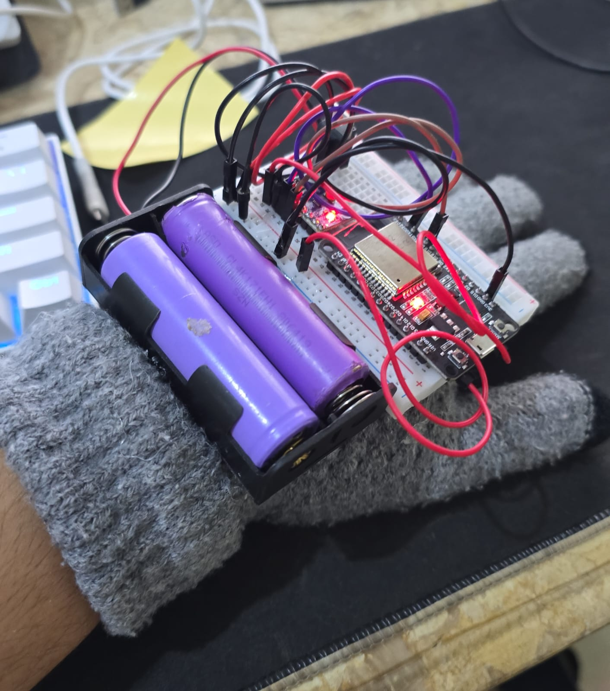

# Wireless Mouse Glove (ESP32 + MPU6050)

A wearable Bluetooth mouse that turns hand movements into cursor controls. Gentle wrist tilts move the pointer, while quick rotations trigger left/right clicks and scrolling.

Built around an **ESP32** and **MPU6050** motion sensor, this project explores motion-controlled interfaces using embedded electronics and Bluetooth Low Energy (BLE).

## Prototype and demo



**[Watch the demonstration video](media/demo.mp4)**

## How it works

The MPU6050 measures acceleration and angular velocity. After a short calibration in a neutral hand position, the ESP32 uses the sensor readings to distinguish gentle tilts from quick rotational gestures and sends wireless mouse commands using BLE HID.

| Glove motion | Mouse action |
| --- | --- |
| Gentle left/right tilt | Move cursor horizontally |
| Gentle up/down tilt | Move cursor vertically |
| Quick rotation along the click axis | Left or right click, based on direction |
| Quick rotation along the scroll axis | Scroll up or down, based on direction |
| Return near the neutral position | Re-arm for another quick gesture |

The code uses **gyro X** for click gestures and **gyro Y** for scrolling by default. The direction may need reversing depending on how the MPU6050 is mounted on the glove.

**Gesture threshold note:** The original control idea was based on roughly 90° wrist rotations. The *included sketch* currently recognizes a rapid gesture after **70°** of integrated rotation, with an initial angular speed of at least **155°/s** and a maximum gesture window of **630 ms**. These values are configurable in the firmware and are not measured results from the demonstration.

## Hardware

- ESP32 development board with Bluetooth Low Energy support
- MPU6050 accelerometer and gyroscope module
- Battery holder and batteries
- Power regulator
- Half-size breadboard
- Glove and jumper wires

See [hardware and setup notes](docs/setup.md) for the pins used in the included sketch and required libraries.

## Software

- **Language:** Arduino C++
- **Board/platform:** ESP32 with Arduino framework
- **Sensor interface:** I²C (`Wire`)
- **Motion sensing:** `Adafruit_MPU6050` and `Adafruit_Sensor`
- **Mouse control:** `BleMouse` (ESP32 BLE Mouse library)

## Repository structure

```text
wireless-mouse-glove-esp32/
├── firmware/
│   └── Wireless_Mouse_Glove/
│       └── Wireless_Mouse_Glove.ino
├── media/
│   ├── prototype.jpg
│   └── demo.mp4
├── docs/
│   └── setup.md
├── .gitignore
└── README.md
```

## Running the firmware

1. Install the **ESP32 board package** in Arduino IDE and the required libraries listed in [setup notes](docs/setup.md).
2. Open `firmware/Wireless_Mouse_Glove/Wireless_Mouse_Glove.ino` in Arduino IDE.
3. Connect the MPU6050 using the correct I²C and power connections; select your ESP32 board and port.
4. Upload the sketch. Hold the glove still in a comfortable neutral pointing position while startup calibration runs (approximately 1.7 seconds of sensor sampling).
5. Pair the Bluetooth device named **`Glove Air Mouse`** with a computer that supports BLE mice.
6. Tilt gently to move the pointer; use quick rotations to click or scroll, then return to the neutral position before the next gesture.

Movement axes, direction, speed, gesture sensitivity, and neutral-position tolerances can be adjusted through constants at the top of the sketch.

## Notes

- This is a **prototype**, not a commercial input device. Performance depends on sensor orientation, calibration, mounting stability, and tuning.
- The demo documents the physical project. The supplied firmware is included as provided and has **not been independently hardware-tested** while preparing this repository.
- Battery/regulator output must match the ESP32 board and MPU6050 module's rated inputs. Verify polarity and wiring before powering the circuit.
